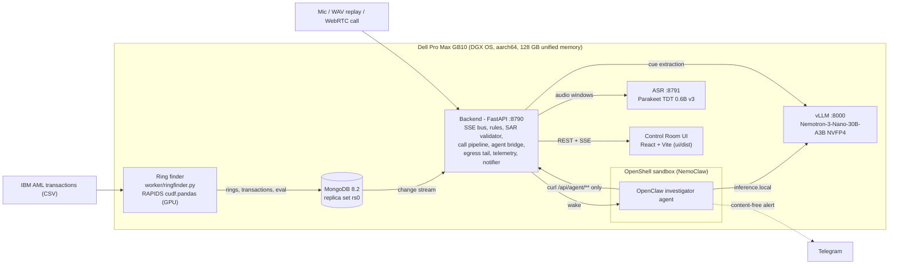

# Fast and Fraudless

**Real-time scam-wire interception and AML ring detection that runs entirely on a local Dell Pro Max GB10, with GPU graph analytics, an agentic SAR drafter and live call transcription, and no cloud calls.**

Built at the Dell x NVIDIA AI Factory hackathon (Boston, 3 Oct 2026).

## Overview

Wire transfers are effectively final. When an elderly customer phones the bank to wire $40,000 "for her grandson's bail", the only moment to stop the scam is while she is still on the line. The data needed to spot it (the live call audio, the bank's account graph, suspicious-activity reports) is too sensitive to send to a cloud API. SAR confidentiality is a legal requirement (31 CFR 1020.320(e)).

Fast and Fraudless runs everything on one Dell Pro Max GB10 inside the bank:

1. A GPU worker keeps replaying the bank's transactions and flags money-mule rings.
2. When it finds a ring, a sandboxed investigator agent wakes up without anyone starting it. It pulls the evidence and drafts a Suspicious Activity Report (SAR), and every transaction it cites is machine-checked against the database.
3. During a live call, speech is transcribed locally. An LLM pulls out scam cues and deterministic code decides. If the payee belongs to a GPU-found ring, the banker sees a **HOLD** card with questions to ask the customer.
4. A live egress log from the sandbox shows on screen that no customer data leaves the box.

The design principle is *models perceive, code decides, humans approve*. The system can recommend a hold and draft a report. It cannot send or release money, file a SAR, or contact a customer.

## Key Features

- **GPU ring finder.** `worker/ringfinder.py` is plain pandas code run under RAPIDS `cudf.pandas` in the RAPIDS 26.08 container, so the same file is both the GPU path and the CPU baseline. It replays the IBM AML transactions on a simulated clock and finds fan-in and fan-out rings over a trailing window. A hub filter drops merchants and banks. Rings, their transactions, and the eval and benchmark results go to MongoDB. No model is involved in detection.
- **Autonomous investigator agent.** The agent is an OpenClaw agent inside an NVIDIA OpenShell sandbox that was set up with NemoClaw. It runs on Nemotron-3-Nano-30B-A3B (NVFP4), which local vLLM serves through `inference.local`. A MongoDB change stream with a persisted resume token wakes it for each new ring. Its skill can only reach `GET/POST /api/agent/**` on the host, and only through `curl` (`agent/policy/tripwire-api.yaml`). It drafts the SAR narrative, and `backend/validator.py` checks every cited transaction ID and amount. An analyst approves or rejects the draft.
- **Call guard.** Parakeet TDT 0.6B v3 transcribes 16 kHz audio in windows of 10 s or less. Audio can come from the browser microphone, a stored WAV replay, or an in-app WebRTC phone line. Nemotron extracts scam cues, each with a verbatim quote that code checks (keyword fallback if the LLM is unreachable). `backend/rules.py` combines the cues, the customer profile and a payee-in-ring lookup into `HOLD` / `VERIFY` / `NO_HOLD`, with reasons and questions. The banker clicks HOLD or RELEASE.
- **Egress proof.** The backend tails `openshell logs` and streams every ALLOWED or DENIED line to the UI. It also shows a "customer data sent out" counter, a demo exfiltration attempt that gets DENIED, and an ONLINE/OFFLINE indicator. The only outside destination is a content-free Telegram alert, and bot tokens are redacted in the log.
- **Prompt-injection hardening.** Caller speech and case data are treated as untrusted. `backend/redteam.py` and `tests/test_injection.py` check that injected instructions do not change decisions and that invented figures fail validation.
- **Self-healing.** systemd user units and a watchdog (`scripts/supervise/`) restart the backend, the ring finder or the agent. Each one resumes from MongoDB.
- **Bank integration surface.** The backend accepts ISO 20022 `pacs.008` / `pain.001` payment screening and core-banking batch ingest. It also provides signed outbound webhooks, a FinCEN-style SAR draft export (XML/JSON), a CSV case export, white-label branding and OpenAPI docs at `/docs` (see `INTEGRATION.md`).

## Architecture



There are three loops:

- **Ring loop (always on).** The ring finder detects a ring and writes it to Mongo. The change stream triggers the agent bridge, which runs the agent with `nemoclaw tripwire agent ...`. The agent fetches the case and posts a SAR draft, the validator marks each citation, and an analyst decides.
- **Call loop (live).** Audio chunks go to ASR, the LLM extracts cues with quotes, `rules.py` decides, and the banker decides.
- **Proof loop.** The OpenShell egress log is parsed into `egress_events`, which feed the SSE log panel and the counters.

`ARCHITECTURE.md` covers the detailed design, the data model and the decision rules.

## Tech Stack

Dell Pro Max GB10, NVIDIA Grace Blackwell, CUDA 13, DGX OS 7 (Ubuntu 24.04), NVIDIA NemoClaw, NVIDIA OpenShell, OpenClaw, vLLM, NVIDIA Nemotron-3-Nano-30B-A3B NVFP4, NVIDIA Parakeet TDT 0.6B v3, Hugging Face Transformers, RAPIDS, cuDF, cudf.pandas, pandas, NumPy, Python 3.12, FastAPI, Uvicorn, Server-Sent Events, MongoDB 8.2, change streams, Docker, systemd, WebRTC, React 19, TypeScript, Vite 7, Tailwind CSS 4, three.js, Motion, pytest, ISO 20022, Telegram Bot API

## Measured Results

The numbers below come from `SUBMISSION.md`. They were measured on the GB10 during the hackathon, on synthetic data. They are self-reported and cannot be reproduced from this repository alone, because the demo audio, scenario file and dataset are not committed.

| Metric | Result | Conditions |
|---|---|---|
| Scam calls caught | 5/5 | 10 synthetic text-to-speech calls through Parakeet, Nemotron cue reading and deterministic rules |
| False holds | 0/5 | Same 10 calls. The legitimate $85k house closing gets VERIFY, not HOLD |
| Laundering attempts recovered | 801 of 2,755 (736 by escalated rings alone) | All 31.9M IBM AML HI-Medium transactions. An attempt counts as recovered if at least 50% of its transactions are ring edges |
| Per-pattern recovery | fan-in 184/355, fan-out 171/345, gather-scatter 206/321, scatter-gather 176/331 | Cycle, stack and bipartite patterns are out of scope |
| Precision | 40.9% escalation tier vs 4.2% all flagged rings | Share of flagged-ring transactions labelled laundering |
| Load + full detection | 16.5 s GPU vs 37.9 s CPU | 31.9M rows, with the GPU serving the LLM at the same time |
| SAR citations | 13/13 verified on the demo ring | The validator also caught a wrong citation on another ring before an analyst saw it |
| Speech to text | 58 s call transcribed in 4.3 s | Parakeet TDT 0.6B v3 on the GB10 |
| LLM throughput | about 60 tok/s | Nemotron-3-Nano NVFP4 on vLLM |

## Getting Started

### Hardware and software required

The full system needs a **Dell Pro Max GB10 or similar NVIDIA Grace Blackwell system** (aarch64, 128 GB unified memory) with Docker and the NVIDIA container runtime, Python 3.12 and Node 22. It was built on DGX OS 7 / Ubuntu 24.04 with CUDA 13.0 and driver 580. The agent stack versions that worked were NemoClaw v0.0.124, OpenShell 0.0.116 and OpenClaw 2026.7.1. `REBUILD.md` lists the exact models, images and versions.

The scripts assume the repo is checked out at `~/tripwire` on the box and that the data and models live under `~/tw/`.

### Bring-up on the box

```bash
# 1. Models
pip install -U "huggingface_hub[cli]"
hf download nvidia/NVIDIA-Nemotron-3-Nano-30B-A3B-NVFP4 --local-dir ~/tw/models/nemotron-3-nano-30b-a3b-nvfp4
hf download nvidia/parakeet-tdt-0.6b-v3 --local-dir ~/tw/models/parakeet-tdt-0.6b-v3

# 2. Container images (arm64)
docker pull nvcr.io/nvidia/vllm:26.05.post1-py3
docker pull vllm/vllm-openai:v0.27.1
docker pull rapidsai/base:26.08-cuda13-py3.12
docker pull mongo:8.2          # use 8.2; 8.0 crashes on kernel 7.0

# 3. Data: copy the IBM AML CSVs (HI-Medium_Trans.csv, HI-Medium_Patterns.txt, HI-Medium_accounts.csv) to ~/tw/data/

# 4. Model servers, then start MongoDB 8.2 as replica set rs0
bash scripts/vllm_up.sh
bash scripts/asr_up.sh

# 5. Backend venv, supervised services, GPU ring finder
bash scripts/backend_setup.sh
bash scripts/supervise/install.sh      # systemd user units tw-backend, tw-worker, tw-watchdog
bash scripts/worker_up.sh

# 6. Agent sandbox (needs TELEGRAM_BOT_TOKEN / TELEGRAM_ALLOWED_IDS for the alert channel)
bash scripts/nemoclaw_onboard.sh
bash scripts/agent_setup.sh
```

### UI

```bash
cd ui
npm install
npm run build        # deploy ui/dist to ~/tripwire/ui/dist; the backend serves it on :8790
```

### Tests

The pytest suite covers the rules, the cue parser, the SAR validator, prompt injection, the integrations and alert sanitising. It runs on any machine without a GPU:

```bash
python3 -m venv .venv && .venv/bin/pip install -r requirements.txt pytest
.venv/bin/python -m pytest tests
```

`RUNBOOK.md` covers status checks, logs and recovery. `ERRORS.md` lists the known on-box problems (E-001 to E-032) and their fixes.

## Project Structure

```
backend/        FastAPI app (:8790): SSE bus, call pipeline, rules, cue extraction, SAR validator,
                agent bridge and agent API, egress tail, telemetry, notifier, integrations, WebRTC relay, red team
worker/         ringfinder.py: GPU ring detection via cudf.pandas (CPU baseline without it)
asr/            Parakeet speech-to-text service (:8791)
agent/          OpenClaw AGENTS.md, investigator skill, OpenShell policy preset
ui/             React + Vite + three.js Control Room and customer caller page
scripts/        Box bring-up scripts; supervise/ holds systemd units and the watchdog
config/         White-label branding and an example integrations file
samples/        Example ISO 20022 pacs.008 / pain.001 messages
tests/          pytest suite
ARCHITECTURE.md, SECURITY.md, INTEGRATION.md, DECISIONS.md, ERRORS.md, RUNBOOK.md, REBUILD.md, SUBMISSION.md
```

## Limitations

- **Synthetic data only.** The transactions come from IBM's synthetic, labelled AML dataset. The customers and the 10 calls are fictional, and the call audio was generated with text-to-speech. One demo wire was planted, with a real labelled feeder account from the IBM data as its payee. The UI labels everything SYNTHETIC. None of this has been tested on real bank data.
- **Needs GB10-class hardware.** The full pipeline (vLLM with an NVFP4 model, RAPIDS, Parakeet and the sandbox) was built for and tested on a Dell Pro Max GB10 (aarch64). Only the backend unit tests run elsewhere.
- **Not reproducible from the repo alone.** The demo call WAVs, `scenario.json` and the IBM CSVs are not committed. The hackathon box was wiped afterwards, so the measured results above cannot be re-run without rebuilding it.
- **Limited detection scope.** The ring finder detects fan-in and fan-out structures. Cycle, stack and bipartite laundering patterns are not covered. Escalation-tier precision is 40.9%, so analysts still review false positives.
- **Pinned to early tool versions.** NemoClaw, OpenShell and OpenClaw were pre-1.0 releases, and the setup depends on the versions listed in `REBUILD.md`.
- **Prototype, not production.** The in-app WebRTC phone line supports a single desk line. Alerts go to Telegram. The SAR export is a FinCEN-style draft, not a filing.

## API Reference

### Contract between backend and UI

#### SSE: `GET /api/events`
Each message is `data: {"type": "<type>", "ts": <epoch ms>, "data": {...}}`.

| type | data |
|---|---|
| `tick` | `{tx_total, tx_per_sec, replay_time}` |
| `ring` | `{ring_id, type, accounts:[str], edges:[{src,dst,amount,ts,txn_id}], total_usd, found_at, status}` |
| `case` | `{ring_id, status: "woke"\|"investigating"\|"sar_drafted"\|"approved"\|"rejected"\|"error", timeline:[{ts,msg}]}` |
| `sar` | `{sar_id, ring_id, narrative, citations:[{txn_id, amount, valid:bool}], valid_all:bool, decision:null\|"approved"\|"rejected"}` |
| `call` | `{call_id, label, customer:{name,age,tenure_years}, payee_account, amount, source:"mic"\|"replay", transcript, cues:[{cue, quote}], payee_check:{in_ring:bool, ring_id, hops, path:[str]}, recommendation:"HOLD"\|"VERIFY"\|"NO_HOLD"\|null, reasons:[str], questions:[str], banker_decision:null\|"hold"\|"release", ended:bool}` |
| `egress` | `{ts, verdict:"ALLOWED"\|"DENIED", process, dest, policy, reason}` |
| `counters` | `{customer_data_out, alerts_sent, denied_total}` |
| `telemetry` | `{gpu_util, temp_c, power_w, mem_used_gb, mem_total_gb}` |
| `bench` | `{rows, cpu_s, gpu_s}` |
| `eval` | `{rings_recovered, rings_total, flagged_precision, scam_caught, scam_total, false_holds, normal_total}` |
| `net` | `{online:bool}` |
| `watchdog` | self-healing status from the watchdog (e.g. `{checks, recoveries, last_recovery}`); optional |
| `eval` (red-team fields) | `redteam_attempts, redteam_decision_changed, redteam_invented_facts_passed, redteam_data_out` (present once the red-team has run) |
| `health` | `{uptime_s, restored:bool}` |

#### REST
| Method | Path | Body / notes |
|---|---|---|
| GET | `/api/state` | Snapshot of the latest of every type above (initial load) |
| POST | `/api/calls/start` | `{scenario?: "CALL-01".."CALL-10"}` → `{call_id}` |
| POST | `/api/calls/{id}/audio` | raw little-endian float32 PCM, 16 kHz mono (≈2 s per POST) |
| POST | `/api/calls/{id}/replay` | `{clip:"CALL-01"}`: server feeds the stored WAV through the same pipeline; the UI plays `/api/audio/{clip}` |
| POST | `/api/calls/{id}/end` | |
| POST | `/api/calls/{id}/decision` | `{decision:"hold"\|"release"}` |
| POST | `/api/sar/{sar_id}/decision` | `{decision:"approve"\|"reject"}` |
| POST | `/api/demo/exfil` | the sandbox tries an outbound POST and the DENIED line shows up |
| GET | `/api/audio/{clip}` | WAV file |
| GET/POST | `/api/agent/**` | **only** paths the sandboxed agent may call (see agent/policy) |
| GET | `/api/rings/{ring_id}` | one ring (any tier), e.g. the payee's ring during a call |
| POST | `/api/integrations/iso20022/pacs008` · `/pain001` | ISO 20022 payment screening → `RING_MATCH` / `CLEAR` / `UNAVAILABLE` + recommendation (see INTEGRATION.md) |
| POST | `/api/integrations/transactions` | core-banking batch ingest (CSV in IBM AML layout or JSON) |
| GET | `/api/integrations/sar/{sar_id}/fincen.xml` · `.json` | SAR draft export (DRAFT, validated citations only) |
| GET | `/api/integrations/cases/export.csv` | case-management export |
| GET | `/api/integrations/branding` · `/health` | white-label config · integration status |

SSE also carries `integration` events `{kind, ref, result}` when a payment message is screened.

Other endpoints in the code: `GET /api/health`, `GET /api/calls/{id}`, and the in-app phone line relay `POST /api/rtc/call`, `GET /api/rtc/state`, `POST /api/rtc/answer`, `POST /api/rtc/hangup` (`backend/rtc.py`). The full OpenAPI schema is served at `/docs`.
